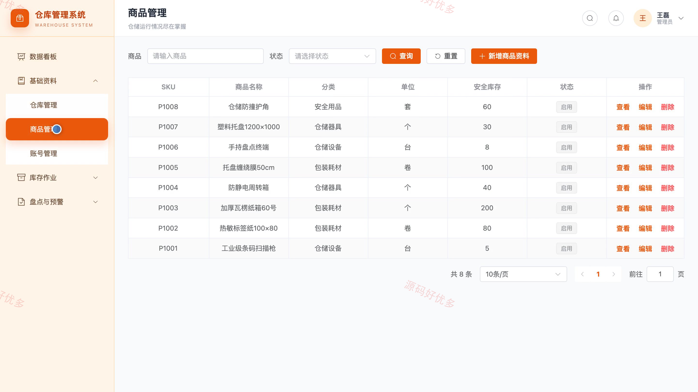
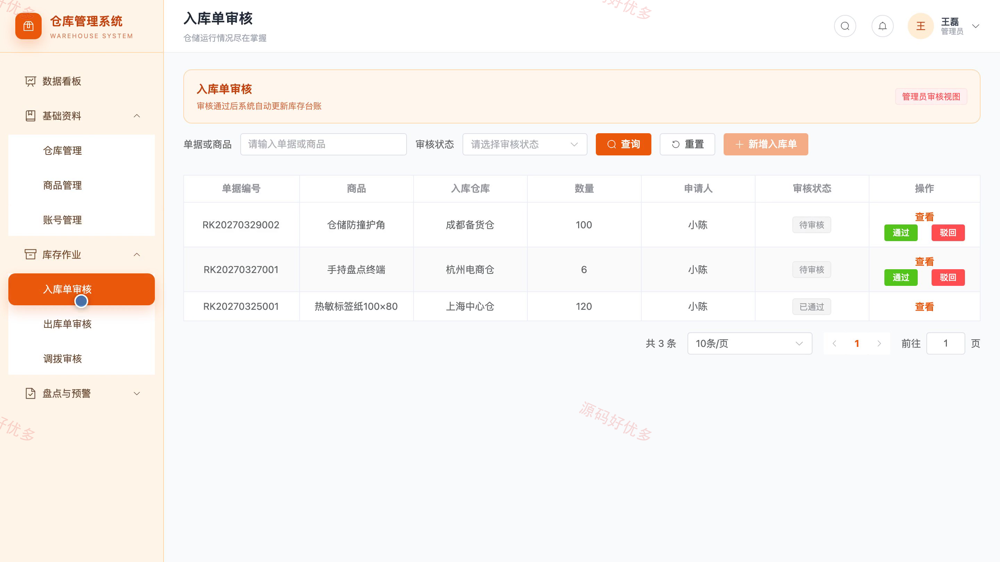
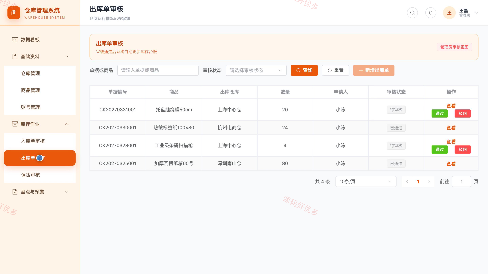
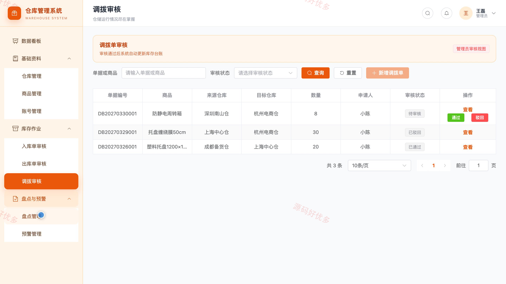
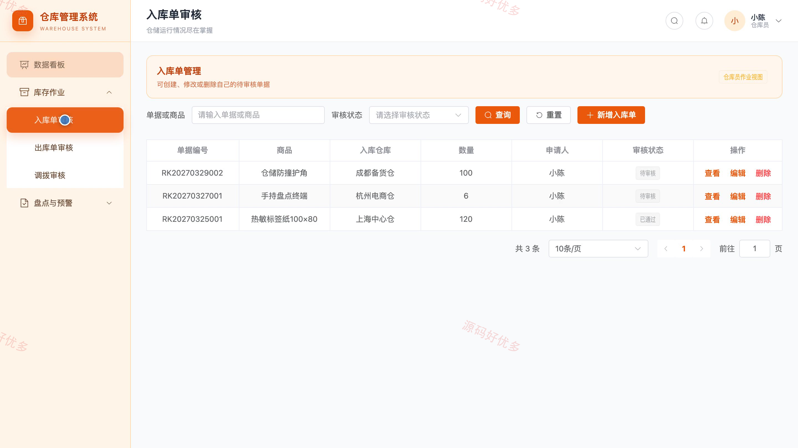
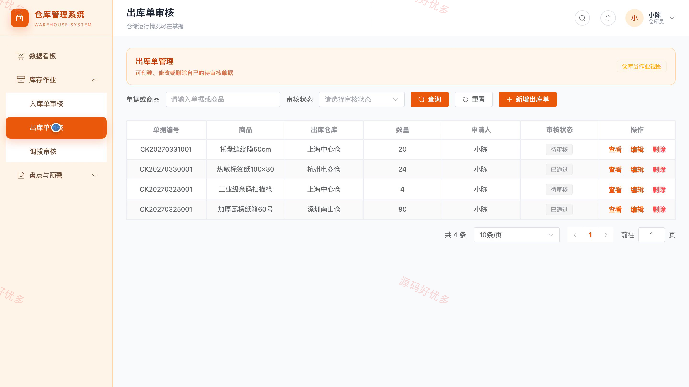
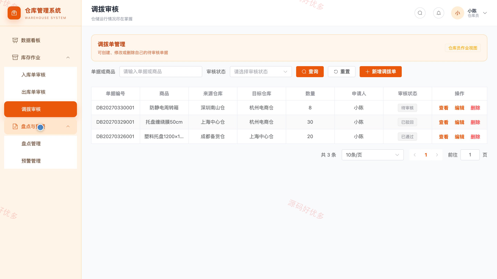

## 源码问题查看主页咨询

### 一、关键词
仓储管理、库存台账、出入库作业、库位管理、库存盘点

### 二、作品包含
源码+数据库+万字设计文档+PPT+全套环境和工具资源+本地部署教程

### 三、项目技术
前端技术： Html、Css、Js、Vue3.4、Element-Plus
后端技术：Java、SpringBoot3.2.0、MyBatis-Plus

### 四、运行环境要求
开发工具：IDEA/eclipse + VSCODE

数据库：MySQL5.7+（共10张表）

数据库管理工具：Navicat10以上版本

环境配置软件： JDK17 + Maven3.6

前端Nodejs：18

浏览器：谷歌浏览器

### 五、项目介绍
项目编号：bs020B

仓库管理系统面向管理员和仓库员，围绕商品、仓库、库存单据、盘点、预警和异常处理建立协同流程。仓库员负责日常入库、出库、调拨、盘点及异常上报，管理员维护基础资料和账号，并审核单据、处理预警与库存差异。

角色：管理员、仓库员

仓库员功能：后台登录、库存数据看板、入库单管理、出库单管理、调拨申请、库存查询、盘点任务与库存预警、异常上报与操作记录。

管理员功能：后台登录、库存数据看板、仓库与库位管理、商品资料管理、仓库员账号管理、出入库调拨单审核、盘点任务与库存调整、库存预警异常与操作记录。

### 六、运行截图

